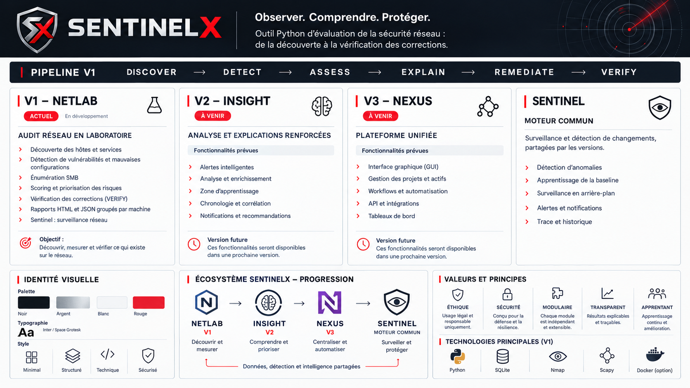

# SentinelX

**Observer. Comprendre. Protéger.**

SentinelX est une plateforme modulaire de cybersécurité qui évolue avec ses besoins : de l'audit réseau en labo jusqu'à une plateforme unifiée et intelligente.


---

## ⚠️ Cadre légal

SentinelX est conçu **exclusivement** pour des réseaux et systèmes que vous possédez, ou pour lesquels vous détenez une autorisation écrite explicite. Toute autre utilisation est illégale. Le cadre de référence du projet est décrit dans [`.kiro/steering/sentinelX.md`](.kiro/steering/sentinelX.md).

---

## Vision

Comprendre comment une attaque fonctionne est le prérequis pour savoir s'en défendre. Chaque fonctionnalité offensive a son pendant défensif — commande d'attaque, technique de détection, méthode de remédiation. SentinelX est déterministe par conception : aucune IA ne décide qu'une vulnérabilité existe. La détection reste basée sur des règles ; l'IA n'arrive qu'en explication, jamais en détection.

## Écosystème — quatre produits, un moteur commun

| Version | Produit | Rôle | Statut |
|---|---|---|---|
| **V1** | **NetLab** — Laboratoire réseau | Audit et tests réseau en environnement contrôlé : reconnaissance, détection, scoring, reporting | 🔵 En développement |
| **V2** | **Insight** — Intelligence & analyse | L'IA au service des résultats : explications enrichies, priorisation, alertes, Zone Apprentissage | ⚪ Planifiée après V1 |
| **V3** | **Nexus** — Plateforme unifiée | Interface graphique et API unifiées, gestion centralisée, tableaux de bord | ⚪ Planifiée après V2 |
| — | **Sentinel** — Moteur de surveillance | Cœur de la détection, présent dans toutes les versions — de la surveillance basique à intelligente | 🔵 Basique en V1 |

*Premier un outil. Puis une intelligence. Puis une plateforme. Un jour, un SOC.*

## Le pipeline central

```
DISCOVER → DETECT → ASSESS → EXPLAIN → LEARN → REMEDIATE → VERIFY
```

| Étape | Rôle | Modules V1 principaux |
|---|---|---|
| DISCOVER | Identifier les actifs et services exposés | `device_fingerprint`, `dns_enum`, `passive_recon` |
| DETECT | Trouver les faiblesses et mauvaises configurations | `tcp_scan`, `udp_scan`, `service_detection`, `smb_enum`, `misconfig_detection`, `default_creds` (FTP et SNMP) |
| ASSESS | Calculer le score de risque de chaque Finding | `risk_scorer` (formule inspirée CVSS, documentée), `assessment` |
| EXPLAIN | Produire une explication en 3 angles | Base de connaissances locale (`knowledge/`) ; IA en V2 uniquement |
| LEARN | Former l'utilisateur de façon interactive | Zone Apprentissage — V2 uniquement |
| REMEDIATE | Appliquer les corrections | Manuel en V1 / scripts automatisés en V2+ |
| VERIFY | Rescanner et confirmer le correctif | `netlab findings rescan --session <id>` |

## Statut actuel — V1 NetLab

Dernier commit de référence : `22831668` (branche `a4-arena`). Le workflow GitHub Actions « Tests » est réussi sur ce commit.

| Domaine | Statut | Détail |
|---|---|---|
| Contrat Finding et base SQLite par session | ✅ Implémenté | `core/finding.py`, `core/database.py` |
| Dépendances et `netlab doctor` | ✅ Implémenté | `core/dependencies.py` vérifie `nmap` et `enum4linux-ng` |
| Scoring | ✅ Implémenté | `core/risk_scorer.py` |
| CLI | ✅ Implémenté | `cli.py` : scan, findings, report, sentinel, creds, config, cleanup |
| Reconnaissance et découverte | ✅ Implémenté | `recon/` |
| Détection réseau et misconfigurations | ✅ Implémenté | `detect/` : TCP, UDP, SMB, misconfigurations |
| VERIFY (`findings rescan`) | ✅ Implémenté | Voir la section VERIFY |
| Rapports | 🟡 Partiel | HTML et JSON. PDF non pris en charge en V1 |
| Identifiants par défaut (T22) | 🟡 Partiel | FTP et SNMP, coffre chiffré local. Voir la section dédiée |
| Sentinel | 🟡 Partiel | `start`, `status`, `stop`, `report`, baseline et notifications. Points ouverts dans `docs/SENTINEL-*.md` |
| Nettoyage de labo | 🟡 Partiel | Commande `cleanup` présente |
| LEARN (Zone Apprentissage) | ⚪ V2 | Hors V1 |
| REMEDIATE automatisé | ⚪ V2+ | Hors V1 |

**Travaux restants sur T22** (à mettre à jour à chaque lot) : règle des trois timeouts, SSH avec mot de passe, SMB. Telnet, HTTP, HTTPS et RDP sont reportés hors V1.

Détail des tickets : `.kiro/steering/sentinelX.md` (identifiants #001 à #020). Documentation complémentaire : `docs/SENTINEL-FINDINGS.md`, `docs/SENTINEL-LIFECYCLE.md`, `docs/SENTINEL-NOTIFICATIONS.md`, `docs/T22-CREDENTIALS.md`.

## Commandes principales (V1)

Les commandes ci-dessous utilisent le préfixe `netlab`, nom de la CLI principale. Le script `netlab` n'est pas encore déclaré dans `pyproject.toml` ; seul le point d'entrée `sentinel` l'est.

| Commande | Rôle |
|---|---|
| `netlab doctor` | Vérifie l'environnement : Python, `nmap`, `enum4linux-ng` |
| `netlab scan` | Lance le scan d'une cible autorisée, avec confirmation avant trafic actif |
| `netlab whois <ip ou domaine>` | Enumération DNS/WHOIS passive, affichage seulement |
| `netlab smb_enum --target <ip>` | Enumération SMB via `enum4linux-ng`, avec confirmation |
| `netlab creds_check --target <ip>` | Vérification explicite des identifiants par défaut (`--service ftp\|snmp`, `--dict`, `--profile`) |
| `netlab creds list` / `netlab creds show <id>` | Consultation du coffre chiffré ; `show` exige une confirmation et un terminal interactif |
| `netlab findings list\|show\|explain\|rescan` | Consultation des Findings et revérification (`rescan --session <id>`) |
| `netlab report generate --session <id> --format html\|json` | Génération d'un rapport |
| `netlab sentinel start\|status\|stop\|report` | Surveillance Sentinel |
| `netlab config show\|set`, `netlab cleanup` | Configuration et nettoyage des artefacts de labo |

## Identifiants par défaut (T22)

- **Périmètre actuel** : FTP et SNMP. SSH par mot de passe et SMB sont prévus en V1 mais ne sont pas encore implémentés. Telnet, HTTP, HTTPS et RDP sont hors V1.
- **Cible** : une seule adresse IPv4 par exécution. Chaque service demande sa propre confirmation ; il n'existe pas d'option `--yes` pour cette commande.
- **Budgets** : 3 tentatives par service, 2 par compte (1 pour SNMP), 10 au total. Intervalle de 2 secondes entre tentatives. Délai maximal de 10 secondes par tentative FTP et de 5 secondes par requête SNMP.
- **Coffre chiffré** : `~/.netlab/credentials/vault.enc`, chiffrement AES-256-GCM, dérivation de clé scrypt. Seuls les identifiants acceptés y sont enregistrés. La phrase de passe doit faire au moins 20 caractères, et l'écriture du coffre est vérifiée avant tout trafic réseau.
- **Dictionnaire** : `--dict` remplace entièrement le catalogue intégré, sans fusion. Le fichier est validé en totalité avant tout test.
- **Résultats** :
  - `SUCCESS` : identifiant accepté. Enregistré dans le coffre, et Finding seulement si le catalogue le qualifie.
  - `READ_UNPROVEN` (SNMP) : l'agent a répondu, mais la lecture n'est pas démontrée. Non enregistré, pas de Finding, sortie 1.
  - `NO_MATCH` : rejet explicite par le service.
  - `TIMEOUT`, `INCONCLUSIVE`, `INACCESSIBLE`, `ERROR`, `LOCKED`, `ANONYMOUS_ACCESS` : résultats non concluants. Ils ne sont jamais assimilés à un identifiant invalide, et un accès anonyme n'est jamais considéré comme un identifiant par défaut.
- **Validation** : les tests utilisent des simulations sans trafic réel. La validation sur matériel ou labo réel reste à faire séparément.

## Stack technique (V1)

- **Langage** : Python 3.11+ (`requires-python >=3.11`), cross-platform Windows + Linux
- **CLI** : [Typer](https://typer.tiangolo.com/)
- **Affichage terminal** : [Rich](https://github.com/Textualize/rich)
- **Persistance** : SQLite (stdlib), un fichier par session
- **Coffre chiffré (T22)** : `cryptography`, `portalocker`
- **Autres dépendances** (`requirements.txt`) : `scapy`, `dnspython`, `python-whois`, `jinja2` (rapports HTML), `pyyaml`, `packaging`
- **Outils externes** : `nmap`, `enum4linux-ng`, vérifiés par `netlab doctor`

## Valeurs

- **Éthique** — usage légal et responsable uniquement
- **Sécurité** — conçu pour la défense et la résilience
- **Modulaire** — chaque module est indépendant et extensible
- **Transparent** — explications claires, traçabilité totale (aucun score sans formule visible)
- **Apprenant** — apprentissage continu et amélioration

## Installation

> 🚧 Procédure d'installation non finalisée. Prérequis : Python 3.11+ et les dépendances listées dans `requirements.txt`.

## VERIFY

`netlab findings rescan --session <id>` vérifie les Findings de la session originale sans créer une nouvelle session. Le contrôle est ciblé selon le module : TCP et UDP rescannent le port concerné ; les misconfigurations utilisent la règle nécessaire, par exemple TCP 80 et 443 pour `http_no_https`, ou UDP 161 pour `snmp_exposed`.

Une Finding encore observée reste `OPEN`. Une Finding absente devient `VERIFIED` uniquement si son contrôle s'est terminé correctement. Un contrôle échoué, annulé, incomplet ou non supporté conserve l'ancien statut et produit un résultat VERIFY `PARTIAL` ou `FAILED`. VERIFY ne crée jamais automatiquement `REMEDIATED`, et les Findings `ACCEPTED` sont exclues par défaut.

Le matching utilise un fingerprint stable dérivé du contexte de session et de l'identité de la Finding ; l'UUID généré à la détection ne sert pas à reconnaître une Finding lors d'un rescan.

## Licence

GNU General Public License v3.0 (GPL-3.0). Le texte complet est dans le fichier [`LICENSE`](LICENSE) de la branche `main`.

> Note : la branche `a4-arena` (commit `22831668`) ne contient pas encore ce fichier ; le lien ne fonctionne donc qu'à partir de `main` ou après intégration de `a4-arena`.

## Auteur

Développé par [Gédéon](https://github.com/GedeonTch) — étudiant en cybersécurité et développement informatique.
